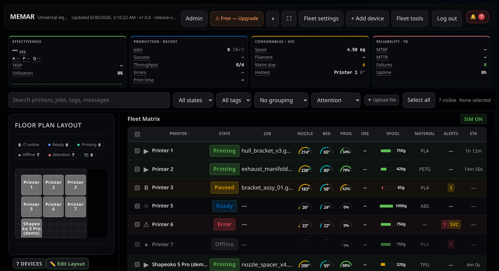
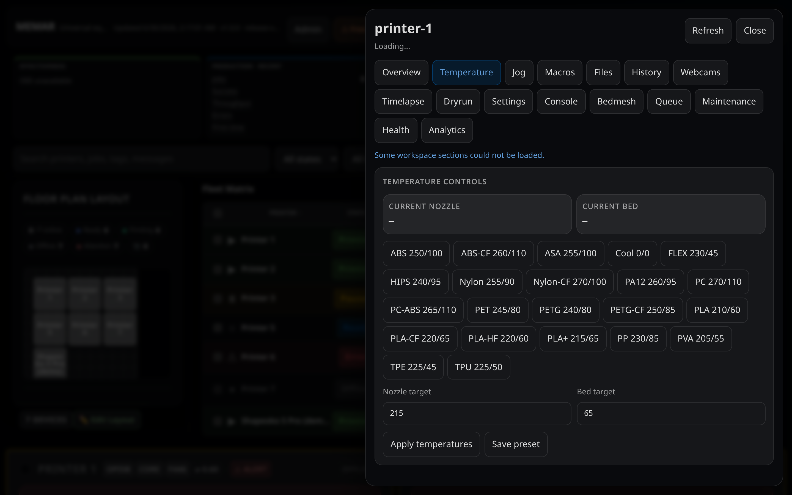
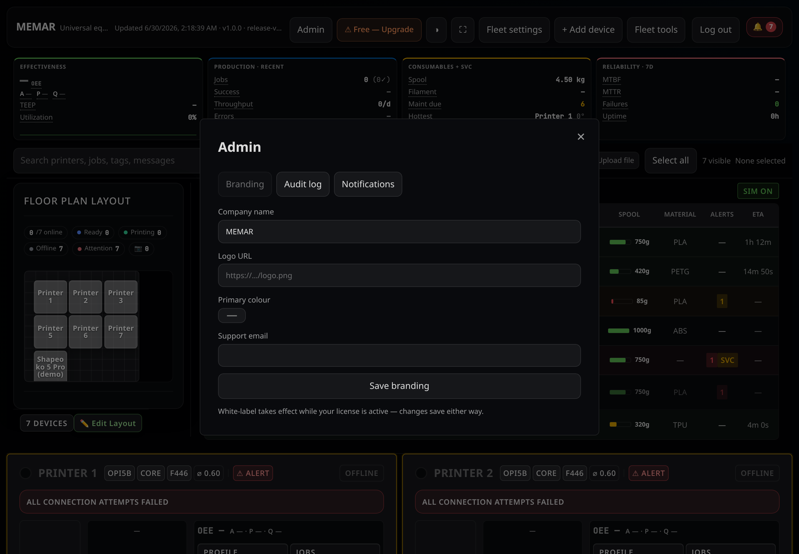
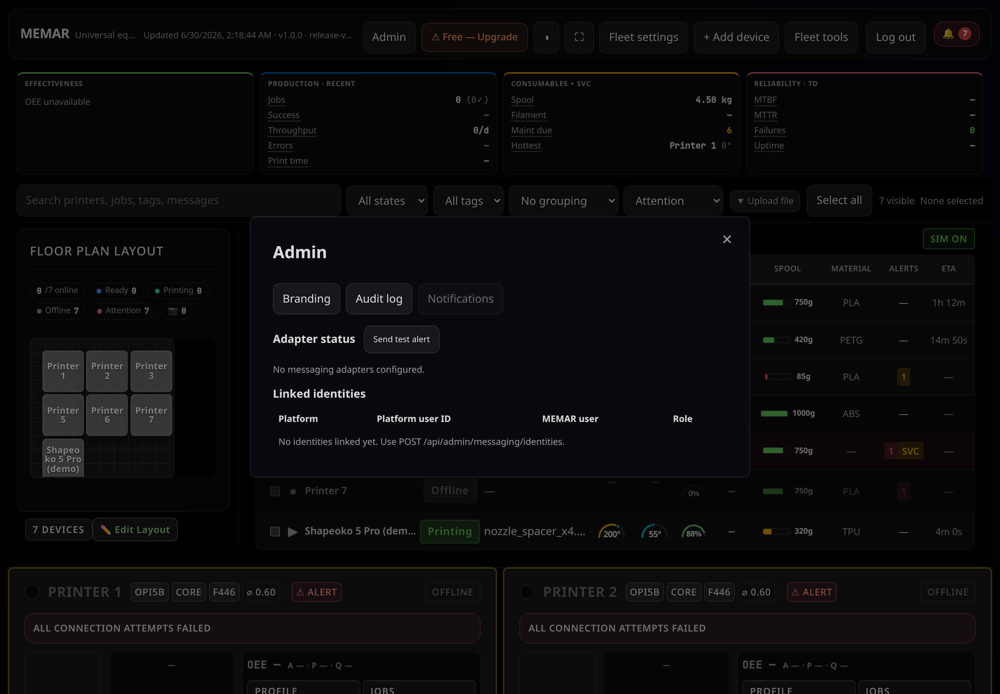
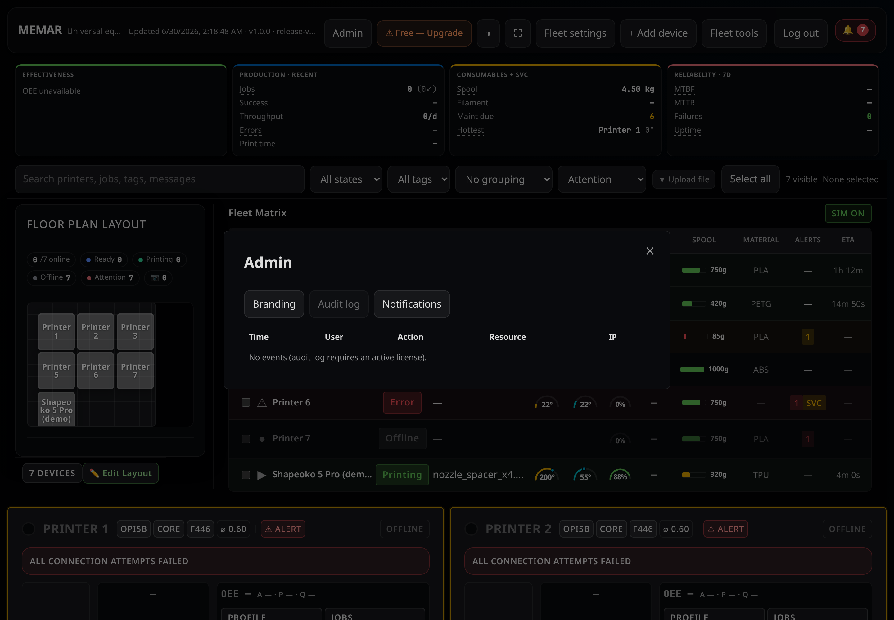

# MEMAR

**Mesh Equipment Monitoring, Analytics & Rendering** — Self-hosted fleet monitor for 3D printers, CNC, lasers, and any equipment with a REST API.

[](https://github.com/stratum-industries-foss/memar/actions/workflows/ci.yml)
[](LICENSE)
[](docker-compose.yml)
[](LICENSE)
[](Dockerfile)
[](frontend/package.json)
[](INSTALL.md)


---

## Key Features

- **Multi-device dashboard** — Real-time fleet status across mixed equipment types
- **OEE metrics** — Availability × Performance × Quality per device
- **Floor plan overlay** — Drag-drop device placement with live status visualization
- **Webhook events** — `printer.error`, `printer.complete`, `printer.offline`, etc.
- **Role-based access control** — Admin, operator, viewer roles with JWT auth
- **Single sign-on** — SAML 2.0 (paid plans): pinned identity-provider certificate, signed-response checks, accounts kept separate from local ones
- **API tokens** — Admin-created personal tokens, hashed at rest, read or full scope, revocable and expiring
- **Tamper-evident audit log** — Hash-chained entries with a verification endpoint and a compliance export
- **Offline licensing** — Ed25519-signed license keys, flat-rate licensing (no per-machine fees)
- **Adapter ecosystem** — 18 machine adapters: **6 supported** (Klipper/Moonraker, OctoPrint, Prusa Connect, Marlin, Duet, FluidNC) and **12 alpha** (Bambu Lab, generic MQTT, GRBL, LinuxCNC, Mach3, Mach4, OPC-UA, Sinumerik, Haas, Fanuc, Fadal, OpenPCB/OpenPnP). Equipment types (FDM, SLA, CNC, laser, plasma, waterjet, vinyl, pick-and-place, wire EDM) are available as device labels; dedicated adapters exist only for the protocols listed. ⚠️ Bambu Lab uses reverse-engineered APIs (unverified against live hardware). The four CNC controllers **Haas, Fanuc, Fadal, and Mach4 are unverified against real hardware — emergency-stop is not guaranteed**; treat as pilot/roadmap until validated on your machine (see the status table below)
- **Messaging hub** — Fan-out alerts to Telegram, Slack, Discord, ntfy, Mattermost, Matrix, or any webhook. Chat commands (status, acknowledge) on Telegram, Matrix, and Mattermost, and on Slack/Discord when configured with bot tokens; ntfy and generic webhooks are outbound only.
- **Notifications** — Configurable alert channels. No required cloud service and no vendor telemetry; data leaves your network only through integrations you enable (chat services, SMTP, Stripe, identity providers).

---

## Feature & Adapter Status

6 adapters are supported (Klipper/Moonraker, OctoPrint, Prusa Connect, Marlin, Duet, FluidNC). 12 adapters are **alpha** — Bambu Lab (reverse-engineered APIs, unverified against live hardware) plus 11 CNC/industrial adapters — monitoring works, but validate control paths on your own equipment before relying on them.

| Feature / Adapter | Status | Notes |
|---------|--------|-------|
| SSO / OIDC | Beta | OIDC auth-code flow fully implemented (`/oidc/login` + `/oidc/callback`). LDAP login also available. Enable by setting the `MEMAR_OIDC_*` issuer/client variables (or Admin → Settings) on a licensed instance. Test before using in production. |
| Modbus adapter | Planned | Not implemented; the protocol value reports an offline "not yet supported" status. |
| Coolant PSI gauge | Alpha | Schema and alerts built; requires CNC adapter that reports float PSI values. |
| CNC controllers — Haas, Fanuc, Fadal, Mach4 | Alpha ⚠️ | Implemented but **unverified against real hardware; emergency-stop is not guaranteed.** Pilot/roadmap only — validate on your machine before production control. |
| Other alpha adapters — MQTT, GRBL, LinuxCNC, Mach3, OPC-UA, Sinumerik, OpenPCB/OpenPnP | Alpha | Real protocols implemented; several need an external bridge/gateway and are not yet validated on live equipment. OPC-UA ships placeholder NodeIds that must be configured; generic MQTT is config-mapped. Monitoring works; test control paths first. |

---

## Screenshots


*Fleet Matrix — mixed print states, live temps, progress, ETA, and spool levels across 7 devices (demo data)*


*Workspace — custom material presets with one-click temperature apply (create and save your own)*


*Admin panel — white-label branding controls*


*Admin panel — multi-channel notification routing*


*Admin panel — full audit log with actor, action, and timestamp*

---

## Quick Start

Docker (any Linux, macOS or Windows with Docker):

```bash
git clone https://github.com/stratum-industries-foss/memar && cd memar
docker build -t memar:local .
docker run -d --name memar --restart unless-stopped -p 8000:8000 -v memar-data:/app/data memar:local
docker logs memar        # prints the one-time setup link. Open it to create the admin account.
```

Nothing needs to be configured first. A prebuilt image will be published with the first release; until then, build it from source as above.

Linux installer (systemd service, no Docker):

```bash
git clone https://github.com/stratum-industries-foss/memar
cd memar
bash install.sh
```

The installer works on Debian, Ubuntu, Raspberry Pi OS, Armbian, Fedora/RHEL, Arch and openSUSE, on x86_64, arm64 and armv7. It installs dependencies, builds the UI, installs the `memar` service and prints the setup link. Options: `--port N`, `--docker` (installs Docker from your distro and starts MEMAR with compose), `--no-service` (no systemd; prints a foreground run command), `--license KEY` or `--license-file PATH` (paid and air-gap licences; the key is never printed). Afterwards, `sudo memar setup-link` shows the link again.

Paid or air-gap licence: add `-e MEMAR_LICENSE_KEY=...` to the `docker run` command, or enter the key in the setup screen or later under Settings → License. An air-gap licence makes the setup code mandatory.

See [INSTALL.md](INSTALL.md) for full setup, optional settings and dev mode.

---

## Tech Stack

| Layer | Tech |
|-------|------|
| Backend | FastAPI, SQLAlchemy, SQLite |
| Frontend | React 18, Vite, TypeScript |
| Auth | JWT (HS256) + bcrypt |
| Licensing | Ed25519 offline signatures |
| Adapters | 18 protocols (Klipper, Bambu, Prusa, GRBL, OPC-UA, Mach, Fanuc, Haas, and more) |

---

## Project Structure

```
backend/app/
  main.py         FastAPI app, routes, event bus
  auth.py         JWT, user mgmt, RBAC
  license.py      License verification & pricing tiers
  oee.py          OEE calculation (Availability × Performance × Quality)
  fleet.py        Device registry & health
  webhooks.py     Event dispatch (SSE + webhooks)
  models.py       SQLAlchemy schemas

frontend/src/
  App.tsx         Main React component + routing
  api.ts          Fetch wrapper with auth & retry
  components/     Dashboard, device cards, floor plan
  
tools/
  keygen/         License key generation (offline)
```

---

## Deployment

See [INSTALL.md](INSTALL.md) for full setup — Docker, bare-metal systemd, dev mode, Stripe webhook, and license key generation.

Production assets: `deploy/systemd/memar.service` and the root `docker-compose.yml`.

See [docs/OPERATIONS.md](docs/OPERATIONS.md) for restart, backup, upgrade, migrations, secret rotation, and health checks.

---

**Part of [Stratum Industries](https://stratum.industries).**  
Licensed under AGPL-3.0.
